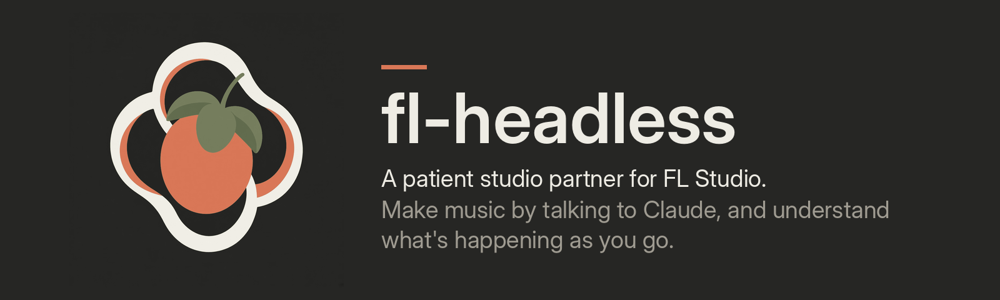

  

  
  
  
  
  
  
  

  <a href="https://github.com/sertifex/fl-headless/releases/latest"><b>Download</b></a>
  &nbsp;&middot;&nbsp;
  <a href="#install"><b>Install in 4 steps</b></a>
  &nbsp;&middot;&nbsp;
  <a href="#things-you-can-say"><b>What you can say</b></a>
  &nbsp;&middot;&nbsp;
  <a href="docs/accessibility.md"><b>Accessibility</b></a>
  &nbsp;&middot;&nbsp;
  <a href="CHANGELOG.md"><b>Changelog</b></a>

> [!NOTE]
> **Beta.** Version 2.1.0 is the first public release, tested on one setup so far (Windows 11, FL Studio 2026).
> Expect some rough edges, and please [report what breaks](https://github.com/sertifex/fl-headless/issues).

fl-headless is not built to make your music for you. It's built to help you make it: it explains what's going on in
your project, takes care of the fiddly steps, and shows you what it changed and why. Your ideas and your taste stay
in charge, and it says honestly when only your ears can decide.

## Why fl-headless

<table>
<tr>
<td width="33%" valign="top"><b>Talk instead of click</b> Ask in plain words. Claude builds, edits, arranges and mixes in the FL window you already have open.</td>
<td width="33%" valign="top"><b>Never loses your work</b> Every edit is backed up first, deletes go to the Recycle Bin, and it never saves an old copy over a newer one.</td>
<td width="33%" valign="top"><b>Explains itself</b> Each step says what it did and why, and admits what it couldn't check.</td>
</tr>
<tr>
<td valign="top"><b>Built for accessibility</b> Designed for people who can't hear the speakers well, can't see the screen or can't use a mouse.</td>
<td valign="top"><b>Private</b> Everything stays on your PC. No accounts, no tracking, no telemetry.</td>
<td valign="top"><b>Free</b> Open source under GPL-3.0. Uses FL's stock plugins, and higher-tier ones only when you own them.</td>
</tr>
</table>

## Things you can say

> *"Make me a lofi beat, around 80 BPM, dusty and warm."*

> *"The chorus feels flat - make it bounce more."*

> *"I'm hard of hearing - tell me in words what changed since the last version."*

> *"What did you just change, and why? I want to learn how to do it myself."*

Under the hood: a free [MCP](https://modelcontextprotocol.io) server for FL Studio on Windows. It reads and
writes `.flp` project files directly, drives the open FL through a small script that runs inside FL, listens to what
FL plays, and renders with FL's own export.

---

## Requirements

- Windows 10 or 11
- FL Studio 20.8 or later
- Claude Desktop
- A MIDI loopback for live control: Windows 11 has one built in, or use the free
  [loopMIDI](https://www.tobias-erichsen.de/software/loopmidi.html). Setup tells you which.

## Install

1. Download **`fl-headless.mcpb`** from the [latest release](https://github.com/sertifex/fl-headless/releases/latest).
2. In Claude Desktop: **Settings > Extensions > Advanced settings > Install Extension**, and pick the file.
3. Pick your song folders, then **Save**.
4. Start a new chat and say: **"I'm new to fl-headless - set me up."**

Claude checks FL, your song folders and the connection, and walks you through anything left. Then try
*"make me a lofi beat"* and press play in FL. Other ways to install, updating and uninstalling:
[install guide](docs/install.md).

## Learn more

- [Using fl-headless](docs/guide.md) - the setup checklist, how it works, and everything you can ask for
- [Accessibility](docs/accessibility.md) - working without hearing the speakers, seeing the screen or using a mouse
- [Install guide](docs/install.md) - install.bat, connecting FL by hand, updating, uninstalling
- [Safety, privacy and honesty](docs/safety.md) - what it can and can't touch on your PC
- [Troubleshooting and FAQ](docs/help.md)
- [Contributing](CONTRIBUTING.md) and [security issues](SECURITY.md)
- [Changelog](CHANGELOG.md)

## License

fl-headless is free and open source: the code is under the **GNU GPL v3 or later**, see [LICENSE](LICENSE) and
[NOTICE.md](NOTICE.md). Use it for anything, including selling the music you make with it. If you share a changed
version, it has to stay free and open with its source.

The **name "fl-headless" and its logo** are not covered by the GPL: they're only for use with fl-headless itself
(a fork needs its own name and logo; see [NOTICE.md](NOTICE.md) and
[data/theme/LICENSE.md](data/theme/LICENSE.md)). The theme's colors are GPL like the code.

Like it? Donations keep it going: [Ko-fi](https://ko-fi.com/F3B5292D61).
Made by [sertifex](https://github.com/sertifex). Not affiliated with Image-Line; FL Studio is a trademark of Image-Line.
